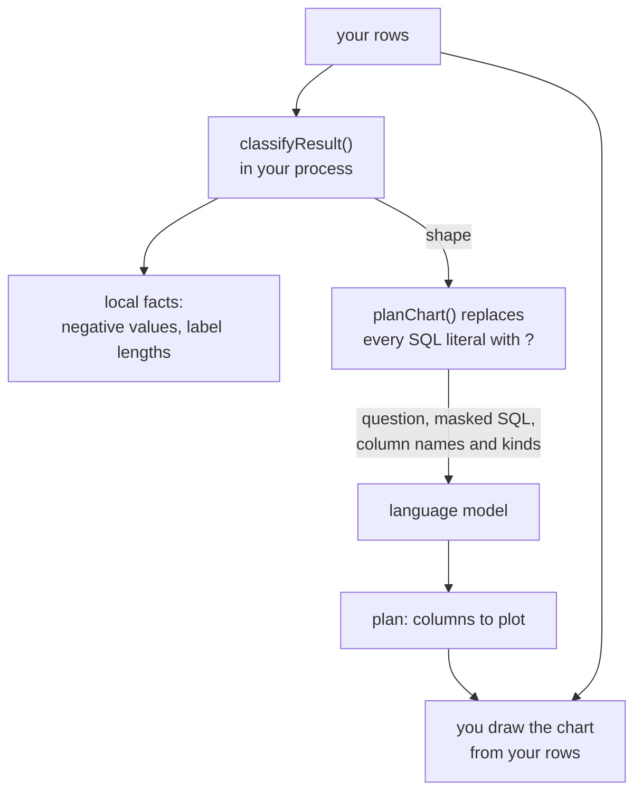

import { Aside, Badge } from "@astrojs/starlight/components";
import InstallTabs from "../../../components/InstallTabs.astro";
import AgentPrompt from "../../../components/AgentPrompt.astro";

Ask a model which chart fits a query result, then draw it from your own rows. The model never sees a row value: `@askdb/client/charts` sends it the question, the SQL with every literal replaced by `?`, and the result's column names and kinds.

<Aside type="caution" title="Experimental">
<Badge text="Experimental" variant="caution" /> `@askdb/client/charts` is outside AskDB's stability promise: a minor release of `@askdb/client` may change it ([ADR 0030](https://github.com/Ygilany/AskDB/blob/main/docs/adrs/0030-1-0-promises-checked-sql-only.md)).
</Aside>

## Before you start

- A service that calls `ask()` or `client.ask()` and runs the SQL under your own connection. [Embed in a Node app](/guides/embed-in-node/) builds one.
- A row cap on that connection. A chart from a cut result needs to know it was cut; [Cap the rows a query returns](/guides/cap-the-rows-a-query-returns/) returns `{ rows, truncated }`.
- The packages below. `@askdb/client/charts` imports only `@askdb/client`'s peers, `@askdb/core` and `ai`; the rest are for steps 1 and 3.

<InstallTabs pkgs="@askdb/client @askdb/core @askdb/config @askdb/ai ai @ai-sdk/openai" />

Swap `@ai-sdk/openai` for the AI SDK package your config selects.

## 1. Run the query

Generate the SQL and run it yourself. AskDB returns the SQL and never runs it.

```ts
import { createAskDb } from "@askdb/client";
import { bootstrapAskDbEnv, getAskDbRuntimeConfig } from "@askdb/config";

bootstrapAskDbEnv({ cwd: process.cwd() });
const askdb = createAskDb({ config: getAskDbRuntimeConfig(), schema: { path: "./my-app.schema" } });
const question = "How many orders did each region place last quarter?";
const { sql } = await askdb.ask(question);
const { rows, truncated } = await runCapped(sql); // your own connection and row cap
```

## 2. Classify the result in your process

`classifyResult()` reads the column names, their database types and, if you pass them, the rows. It runs in your process and makes no model call. It returns two parts: `shape`, the only part the model sees, and `local`, facts such as negative values and label lengths that stay in your process.

```ts
import { classifyResult } from "@askdb/client/charts";

const result = classifyResult({
  // Your driver's column list, with each column's database type when it reports one.
  columns: Object.keys(rows[0] ?? {}).map((name) => ({ name })),
  rowCount: rows.length,
  truncated,
  rows, // optional: read here, never sent to a model
});
```

Pass `schema` (the schema artifact `ask()` used) to take a column's type from the artifact when your driver doesn't report one. A result column takes the type of the one schema column with its name; a name shared by two schema columns decides nothing.

## 3. Plan the chart

Pass the question, the SQL and the classified result to `planChart()` with a model. Use the same model wiring as `ask()`: an AI SDK model you build, or one from `@askdb/ai`'s registry.

```ts
import { planChart } from "@askdb/client/charts";
import { createAiRegistry } from "@askdb/ai";

const model = await createAiRegistry().createLanguageModelFromEnv(process.env); // or openai("gpt-4o-mini")
if (!model) throw new Error("No AI provider is configured: set its API key.");
const plan = await planChart({ question, sql, result, model, dialect: "postgres" });
```

Before the model call, `planChart()` replaces every literal in the SQL with `?`: strings, numbers and tenant values bound into the SQL. It finds them with the SQL checks' own lexer, for the `dialect` you pass. An id that isn't built in, a custom dialect, or no dialect reads the SQL the way every built-in engine would, which masks more. If the SQL can't be read safely, for example a string that never closes, the model gets no SQL at all. A column name that holds a literal, such as the name SQLite and MySQL give an unaliased `COUNT(CASE WHEN status = 'refunded' THEN 1 END)`, is shown as `column_2`, and `planChart()` maps the model's answer back to the real name.

If you keep sensitive columns out of prompts (`modes.omitSensitiveFromPrompt`), pass that setting as `omitSensitiveIdentifiers` with the schema artifact as `schema`, as `ask()` takes it. The model then gets no SQL that mentions a sensitive column, and a result column named like one is shown under a `column_<n>` label.

```ts
const plan = await planChart({ question, sql, result, model, dialect: "postgres", schema, omitSensitiveIdentifiers: true });
```

`planChart()` never rejects because of the model. When the model errors, takes longer than `timeoutMs` (15000 by default), returns something that isn't a chart spec, or names a chart that fails the checks, `plan.source` is `"fallback"` and `plan.fallbackReason` says why. The fallback picks a chart from the classified columns with the same rules.

## 4. Draw the chart from your rows

`plan.primary` names the columns to plot. Map them onto your chart library and your own rows:

```ts
if (plan.primary) {
  const { type, category, series, title } = plan.primary;
  renderChart({ type, title, x: category, y: series, data: rows });
}
```

`plan.primary` is null when no column holds a number to plot, or when a result of several rows has no column to group them by. Show the table instead. `plan.alternate`, when set, is a second chart you can offer.

## What the model sees

<figure>



<figcaption>What crosses to the model and what stays in your process. Rows and local facts never leave; the model gets the question, the masked SQL and the result's shape, and returns the columns to plot.</figcaption>
</figure>

| | Sent to the model | Stays in your process |
| --- | --- | --- |
| Question | the question | |
| SQL | the SQL with every literal replaced by `?` | the literal values |
| Result | column names and kinds, and the row count | every row, and local facts such as negative values and label lengths |

For the question above, the model gets this, after fixed instructions that state the rules and hold no data:

```text
Question: How many orders did each region place last quarter?

SQL (literals replaced with ?):
SELECT region, COUNT(*) AS order_count FROM orders WHERE tenant_id = ? AND placed_at >= ? GROUP BY region

Result shape: 6 rows.
Columns:
- region (category)
- order_count (measure)
```

The column names reach the model, as they do in the prompt `ask()` sends, unless omission withholds them. Values don't.

## Use with your agent

<AgentPrompt>

Add chart planning to this project's AskDB service. Follow https://askdb.tools/guides/plan-a-chart.md.

Goal: call `classifyResult()` and `planChart()` from `@askdb/client/charts` on a query result, then draw `plan.primary` from the application's own rows.

- `@askdb/client/charts` is experimental: a minor release of `@askdb/client` may change it.
- Never send rows to a model. Pass the question, the SQL and the classified result.
- AskDB returns SQL and never runs it. The application runs the SQL under its own connection, with a row cap.

</AgentPrompt>

## Read next

- [@askdb/client/charts API](/reference/client-charts-api/): Every option, type and check.
- [Cap the rows a query returns](/guides/cap-the-rows-a-query-returns/): The `truncated` flag the planner reads.
- [Bring your own model](/guides/bring-your-own-model/): Both ways to give the planner a model.
